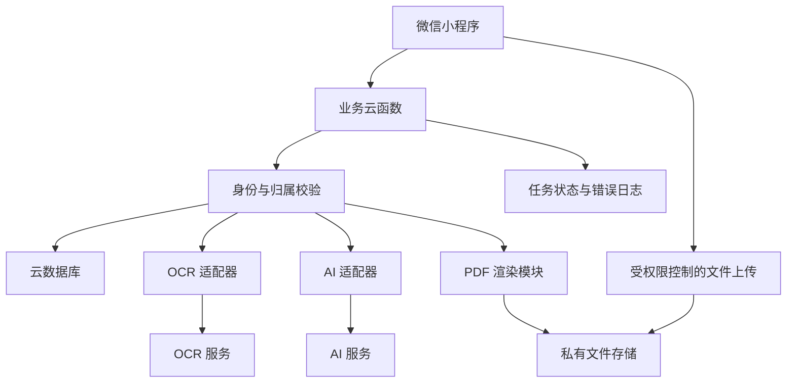
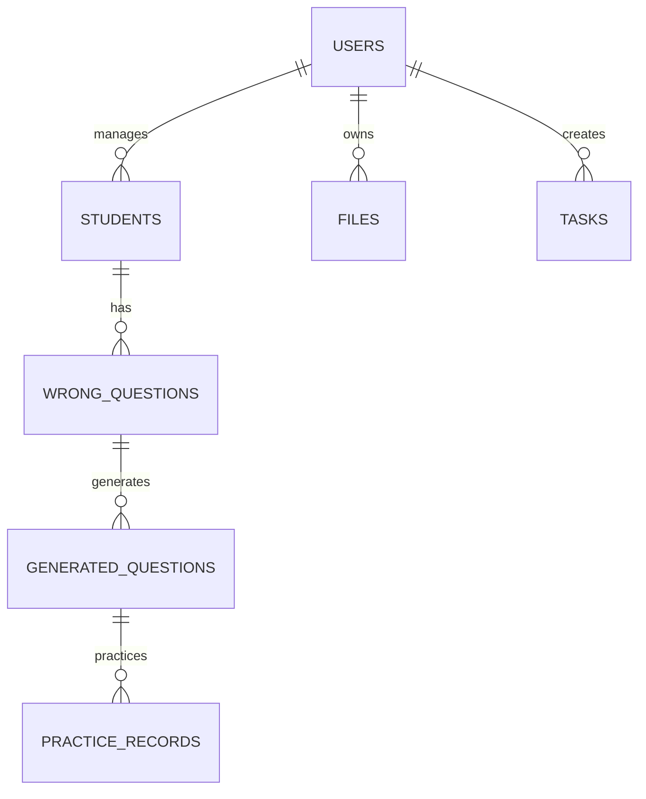
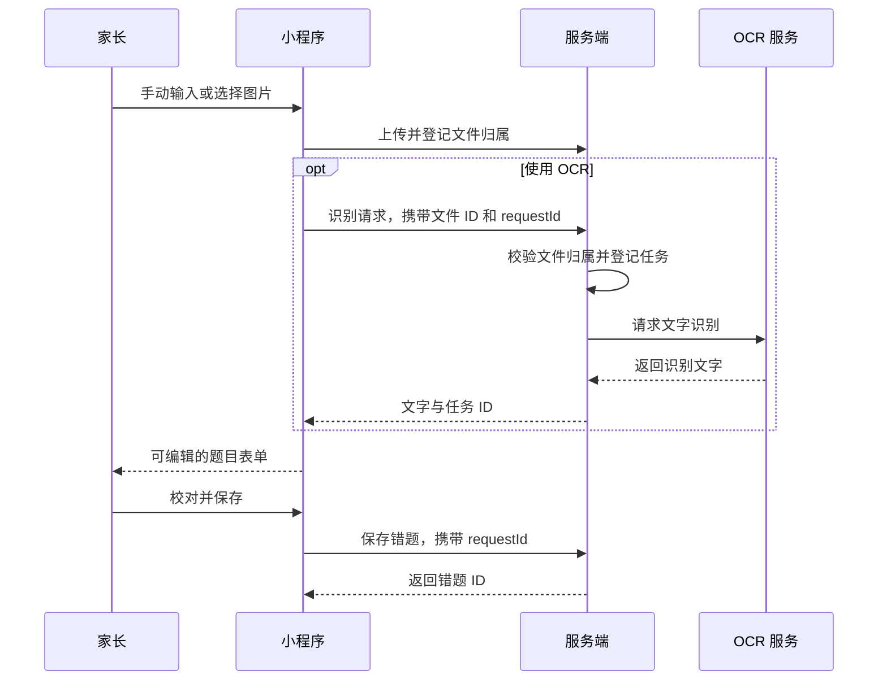

# 小学生语文数学错题知识库小程序系统设计

> 状态：开发前设计稿。需求来源为《需求分析.md》，交付范围见《MVP划分.md》。文中容量、额度和性能均为设计目标，需在部署环境验证。

## 1. 范围与设计决策

核心流程：录入错题 → 用户校对 → 分类保存 → AI 生成同类题 → 家长确认 → 在线练习 → 导出打印。

| 事项 | 第一版决策 | 原因 |
|---|---|---|
| 用户 | 家长或教师以个人身份使用 | 教师可建个人错题库，班级共享后续实现 |
| 学生 | 一个用户可管理多个学生，先完成单学生流程 | 保留多学生需求，降低首轮开发复杂度 |
| 前端 | 原生微信小程序，JavaScript + WXML + WXSS | 适合课程作业，减少跨端框架维护成本 |
| 后端 | 优先微信云开发，业务通过云函数调用 | 集中身份校验、数据访问和外部服务调用 |
| 数据 | 云数据库保存结构化记录，云存储保存文件 | 题目文字与图片、PDF 分开管理 |
| OCR | 通用印刷文字识别 + 人工校对 | 不以手写、竖式和几何图形准确识别为验收条件 |
| AI | 可替换的服务端供应商适配器 | 不在页面内耦合供应商请求和返回格式 |
| 练习 | 客观题按受限规则判定，开放题由家长确认 | 不以字符串相等判定所有语文答案 |
| 导出 | 固定 A4 PDF，两种模板 | 先保证中文、图片、分页和答案隐藏正确 |
| 掌握状态 | 四级状态，由用户更新 | 不根据一次答对自动判为已掌握 |

第一版是按学生和知识点组织的错题知识库，不需要知识图谱或向量数据库。技术方案属于当前建议，供应商选择和部署条件待接入阶段确认。

## 2. 总体架构



业务数据通过云函数读写；前端上传文件使用受权限控制的用户目录。数据库客户端规则默认关闭业务集合直接访问。部署时同时验证云函数和文件权限，不能仅靠前端隐藏按钮。

| 模块 | 职责 |
|---|---|
| 用户与学生 | 当前用户初始化、学生创建与编辑、当前学生切换 |
| 错题 | 校验、分页、筛选、关键词搜索、编辑和删除 |
| 文件 | 图片类型/大小校验、归属登记、下载和孤立文件清理 |
| OCR | 识别文字、统一返回、记录失败、保留人工输入路径 |
| AI | 提示词、JSON 校验、待确认题目、重新生成 |
| 复习 | 作答快照、有限自动判定、家长确认 |
| 导出 | 选题校验、内容快照、固定模板、PDF 生成和下载 |

### 2.1 目录建议

```text
miniprogram/
  pages/                 页面
  components/            错题列表项、筛选栏、题目编辑表单
  services/              统一云函数调用和错误处理
  utils/                 字段格式化和表单校验
  assets/                图标和静态图片
cloudfunctions/
  api/                   普通业务动作入口
  ocr/                   OCR 入口
  generate/              AI 出题入口
  export/                PDF 导出入口
  shared/                共享源码，构建时复制到各部署目录
```

页面不组装外部服务请求。共享模块必须随每个函数部署，不假设运行环境可访问相邻函数目录。

## 3. 页面与导航

底部导航建议为“错题库、复习、我的”，默认进入错题库。统计放在错题库顶部，MVP 不单独开发统计首页。

| 页面 | 主要操作 |
|---|---|
| 错题库 | 切换学生、学科筛选、关键词搜索、分页、勾选导出 |
| 添加/编辑错题 | 手动输入、选择图片、OCR 后校对、保存 |
| 错题详情 | 原图、答案和原因、掌握状态、生成练习、删除 |
| 生成题确认 | 查看本次结果、编辑、删除、重生成 |
| 复习列表 | 选择已确认题目、查看最近记录 |
| 在线练习 | 输入答案、提交、显示解析、家长确认开放题 |
| 导出配置/结果 | 模板、作答空间、生成状态、打开文件 |
| 我的/学生管理 | 添加与编辑学生、当前学生切换 |

OCR 校对复用错题编辑表单；练习结果在提交后展开。页面均需空数据、加载、失败和重试状态。保存失败保留表单，切换学生清空原筛选缓存和导出选题。

## 4. 数据模型

### 4.1 关系



每个业务记录包含 `ownerId`，由服务端解析当前用户身份后填入，前端不能指定或修改。时间由服务端生成；年级使用数字 1 至 6。

### 4.2 集合与字段

| 集合 | 主要字段 | 说明 |
|---|---|---|
| `users` | `_id, openid, displayName, currentStudentId, createdAt` | OpenID 仅服务端使用，不强制头像、手机号 |
| `students` | `_id, ownerId, name, grade, createdAt, updatedAt` | 姓名允许昵称，第一版不收集学校 |
| `wrong_questions` | `_id, ownerId, studentId, subject, grade, chapter, questionType, questionText, sourceFileId, ocrText, studentAnswer, correctAnswer, analysis, errorReason, knowledgePoints, difficulty, mastery, revision, createdAt, updatedAt, deletedAt` | 原图、识别原文和校对文字分别保存 |
| `generated_questions` | `_id, ownerId, studentId, sourceQuestionId, sourceRevision, sourceSnapshot, generationTaskId, subject, questionType, questionText, options, answerSpec, analysis, knowledgePoints, difficulty, status, revision, createdAt, updatedAt, deletedAt` | 来源快照不随原题变化 |
| `practice_records` | `_id, ownerId, studentId, generatedQuestionId, questionSnapshot, userAnswer, judgement, judgeMethod, judgedAt, practicedAt, requestId` | 历史记录不随练习题编辑变化 |
| `files` | `_id, ownerId, storageFileId, purpose, contentType, sizeBytes, createdAt, expiresAt, status` | 图片、PDF 归属与清理依据 |
| `tasks` | `_id, ownerId, studentId, kind, requestId, payloadSnapshot, status, resultRefs, errorCode, startedAt, finishedAt, deadlineAt` | OCR、AI、导出任务状态 |

`sourceFileId` 引用 `files._id`，实际云文件 ID 保存于 `files.storageFileId`。每条错题第一版最多关联一张图片。

### 4.3 枚举与校验

- `subject`：`chinese`、`math`。
- `difficulty`：1 简单、2 中等、3 困难，默认 2。
- `mastery`：`new` 未复习、`reviewing` 复习中、`familiar` 基本掌握、`mastered` 已掌握。
- 生成题 `status`：`draft` 待确认、`confirmed` 已确认、`archived` 停用。
- 作答 `judgement`：`correct`、`incorrect`、`ungraded`。
- `judgeMethod`：`rule` 规则判定、`parent` 家长确认、`none` 尚未判定。

错题必填为学生、学科、年级和题目文字。复杂图形题通过文字描述加原图保存。答案、错误原因和知识点允许暂缺；AI 出题前须补充正确答案、至少一个知识点，并由家长确认原题内容。

### 4.4 索引和查询

- 用户：`openid` 唯一索引。
- 常用列表：`ownerId + studentId + deletedAt + createdAt + _id`。
- 学科筛选：常用列表索引增加 `subject`。
- 复习列表：`ownerId + studentId + status + createdAt`。
- 练习记录：`ownerId + studentId + practicedAt`。
- 幂等控制：`ownerId + 操作类型 + requestId` 唯一约束或确定性记录 ID。

默认每页 20 条，按 `createdAt` 和 `_id` 倒序游标分页。最终索引依据数据库支持情况和实际查询调整。

搜索第一版覆盖题目文字和知识点；服务端限定归属，限制关键词长度，按普通文本转义，不执行用户提交的正则表达式。

## 5. 核心流程

### 5.1 录入和 OCR



无图片时跳过上传。识别失败保留图片和已输入内容，用户可以手动保存。重新识别不得直接覆盖已修改文字，须确认后替换。

建议项目限额：一条错题一张图、单图上传不超过 5 MB，题目正文不超过 6000 字；前后端同时校验。压缩后仍须能够看清题目。

### 5.2 AI 生成和确认

1. 根据错题 ID 读取服务端原题，校验用户、学生、知识点和答案。
2. 固定保存来源题目快照及版本，选择数量 1 至 3 和难度。
3. 将原题作为数据传入固定出题提示词，不执行题目文字中包含的指令。
4. 提示词要求学科、年级、知识点一致，返回结构化题目、答案、解析。
5. 服务端解析 JSON，校验字段类型、枚举、数量、长度、重复题和答案形式。
6. 校验失败则本次任务失败，不把半成品加入题库；MVP 不自动反复调用付费服务。
7. 保存 `draft` 题目，用户逐题编辑、删除、确认。
8. 只有 `confirmed` 题目能进入练习和练习资料导出。

结构正确不代表教学内容正确；数学答案应尽可能用可靠的受限运算规则复核，语文答案由家长确认。第一版不自动判定题目符合所有地区教材进度。

答案结构建议如下，支持判定方式由服务端按题型设置，不由模型自行决定：

```json
{
  "questionText": "32 × 13 =",
  "answerSpec": {
    "mode": "numeric",
    "value": "416",
    "display": "416"
  },
  "analysis": "32×3=96，32×10=320，96+320=416。",
  "knowledgePoints": ["两位数乘两位数"],
  "difficulty": 2
}
```

### 5.3 在线练习和判定

| 答案类型 | MVP 处理方式 |
|---|---|
| 单选题 | 对比选项 ID，不比较显示文本 |
| 单一整数或有限小数的计算题 | 用成熟数值处理库解析并比较；不执行用户表达式 |
| 词语、拼音、应用题、句子修改 | 提交后显示参考答案，家长标记对/错 |
| 分数、多个答案、单位混合、开放题 | 家长确认，不强行自动判定 |

提交时保存题目和标准答案快照。尚未确认的开放题为 `ungraded`，不能统计成答对或答错。家长确认结果和掌握状态变更分别记录；MVP 掌握状态由用户手动更新。

记录按题目逐条保存，不要求第一版建设整套试卷评分系统。退出练习后已提交记录保留，未提交内容提示保存或离开。

### 5.4 PDF 导出

1. 选取同一学生、同一学科的 1 至 20 道原错题，可附加这些原题对应的已确认练习。
2. 校验每道题和附件归属，按用户选择顺序保存导出快照。
3. 选择 A4 练习版或解析版，默认练习版。
4. 读取受限图片，生成 PDF，登记文件归属和任务结果。
5. 前端获取受限文件并打开；用户可以转发给电脑或使用外部打印方式。

“供打印”以输出可打印 PDF 为交付，不要求小程序直接连接打印机。

| 模板 | 内容 |
|---|---|
| 练习版 | 标题、学生昵称、学科年级、题目、必要题图、作答空白 |
| 解析版 | 题目、正确答案、错误原因、知识点、解析，可附同类题答案 |

练习版不写入答案字段、学生原答案或错误解析。原图若含批改、答案或解析，默认不嵌入练习版，须用户裁剪/遮挡后显式确认才能纳入。不能只在小程序预览时隐藏答案。

PDF 模块选用成熟生成库及可合法嵌入的中文字体，具体库在部署验证后确定。验证长文本换页、图片等比缩放、页码、非空白输出、答案隔离和真实打开。MVP 不用图片覆盖整页文字。

## 6. 接口契约

### 6.1 调用方式

采用云函数动作调用，以下为内部逻辑名称，不要求搭建额外 HTTP 服务。

```json
{
  "action": "question.create",
  "requestId": "client-generated-operation-id",
  "data": {
    "studentId": "student_001",
    "subject": "math",
    "grade": 3,
    "questionText": "23 × 14 =",
    "correctAnswer": "322",
    "knowledgePoints": ["两位数乘两位数"]
  }
}
```

响应统一为 `{ok, data, error, traceId}`，其中失败的 `error` 含 `code` 和面向用户的 `message`；列表 `data` 含 `items, nextCursor, hasMore`。

| 动作 | 输入重点 | 输出重点 |
|---|---|---|
| `user.bootstrap` | 服务端获取身份 | 用户资料、当前学生 |
| `student.list/create/update/select` | 学生字段或 ID | 学生列表或记录 |
| `question.create/update/delete` | 字段、ID、版本、requestId | ID 和新版本 |
| `question.list/detail` | 学生、学科、状态、关键词、游标 | 归属范围内列表或详情 |
| `file.register/access` | 文件标识、用途；或登记 ID | 归属记录；或临时访问方式 |
| `ocr.recognize` | 文件登记 ID、requestId | 任务 ID、识别文字 |
| `generation.create` | 来源题 ID、版本、数量、难度 | 任务 ID、候选题 ID |
| `generation.list/update/confirm/delete` | 来源或学生 ID、题 ID、版本 | 候选题或更新结果 |
| `practice.submit/grade/list` | 练习题 ID、答案、requestId；或记录 ID | 判定结果或历史列表 |
| `export.create` | 原题 ID、附加练习 ID、模板、requestId | 任务 ID、文件登记 ID |
| `task.get` | 任务 ID 或原请求 requestId | 状态、结果引用、错误 |

编辑提交 `revision`，服务端发现版本已变化时返回 `CONFLICT`，避免两个页面互相覆盖。服务端永远重新读取并校验引用，不能依赖前端提供的答案和学生归属。

### 6.2 任务与幂等

MVP 使用同步执行加持久化状态：入口先登记任务，再等待 OCR/AI/PDF 操作并写入结果，不使用“返回后继续执行”的进程内后台逻辑。

任务状态为 `running → succeeded / failed`。设定单次外部调用超时及总任务截止时间，均小于部署函数实际时限。首次接入时测量耗时并调整限额；超出同步能力后再设计可靠队列和后台工作器。

- 同一用户、操作、requestId 的重试返回已有任务或结果，避免重复创建内部数据。
- 客户端超时后先查询原任务；仍在运行时等待，不能立刻再次调用付费服务。
- 任务超过截止时间后，通过定时清理或查询时原子更新标记失败，并阻止迟到执行器发布结果。
- 用户明确重新生成时创建新 requestId；第三方调用无法完全去重时可能仍有费用，界面应区分“恢复结果”和“重新生成”。

错误码建议：`VALIDATION_ERROR`、`NOT_FOUND`、`CONFLICT`、`FILE_INVALID`、`RATE_LIMITED`、`PROVIDER_TIMEOUT`、`PROVIDER_FAILED`、`INVALID_AI_RESULT`、`EXPORT_FAILED`。越权 ID 与不存在 ID 统一返回 `NOT_FOUND`。

## 7. 权限、删除与隐私

每个读写动作从服务端身份映射 ownerId，校验所有关联的学生、原题、练习题、文件和任务。云函数以管理权限访问数据库时尤其不能省略归属检查。

文件上传目录绑定当前用户，登记时再次验证路径与归属。云文件 ID 不是公开下载授权。OCR 输入只接受已登记的自有文件，不接受任意外部 URL。

- 第一版只收集学生昵称和年级，调用 AI 时不发送昵称、OpenID 等身份字段。
- 上传含姓名、学校等信息的图片前允许裁剪；首次外部识别提示图片将用于识别。
- 服务密钥放入服务端环境配置，不写入前端、仓库或日志。
- 日志保留 traceId、错误码、耗时和数量，默认不记录原题全文或图片。
- 原错题先软删除，关联练习停用，历史练习记录保留快照；新导出不能选择已删除题。
- 原图仅在不存在有效引用时清理；未绑定文件和过期 PDF 定时清理。
- 学生有错题或记录时，MVP 禁止直接删除学生；完整清除学生及关联数据作为后续专门流程。
- 已导出或转发到外部的文件无法随错题删除自动撤回，应在删除反馈中说明现存文件不受影响。

## 8. 非功能目标与验证

| 项目 | 设计目标和检查方式 |
|---|---|
| 列表 | 每页 20 条；用 100 条数据验证分页、搜索、学生筛选组合 |
| 普通操作 | 在指定测试网络下，常规读取/保存尽量在 2 秒内反馈；记录冷启动影响 |
| 外部服务 | 明确加载和超时反馈；后台记录实际耗时，不承诺固定秒数 |
| 费用 | 服务端限制每次 1 至 3 题、每份最多 20 原题；日配额可配置 |
| 并发 | 重复提交不重复建记录；不同用户引用同一 ID 时拒绝访问 |
| 文件 | 中文显示正常，长题正确分页，图片不压扁、不遮文字 |
| 故障 | OCR 失败仍可录入；AI/PDF 失败不损坏已保存错题 |

重点测试包括其他用户 ID、直接文件访问、非法 JSON、空答案、重复提交、前端超时后恢复、已删除来源、题目编辑后的历史快照、答案藏在原图的导出场景。

## 9. 开发前置条件

1. 准备可开发的小程序 AppID、云环境和部署权限。
2. 确认 OCR 和 AI 供应商的接口、费用、额度、网络连通性和凭据。
3. 验证云函数支持所选 PDF 库和中文字体，产出包含中文、长题、图片的测试 PDF。
4. 配置数据库/存储规则、函数环境变量、超时和项目配额。
5. 开发阶段允许适配器使用明确标记的模拟数据；完整 MVP 验收须真实连接 OCR 和 AI。

这些事项是接入条件，不代表当前已配置完成。班级成员、教师与家长关系、共享权限、手写识别和复杂数学排版在后续版本另行设计。
